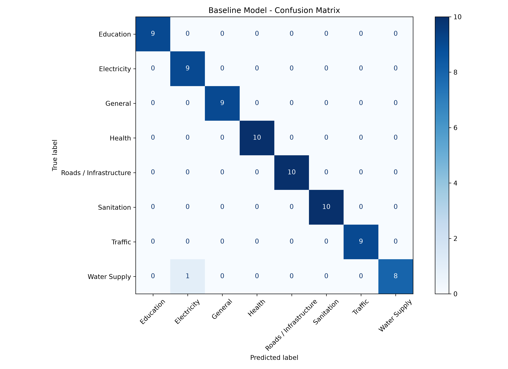
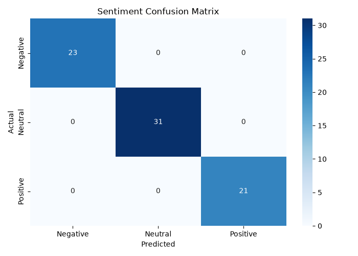
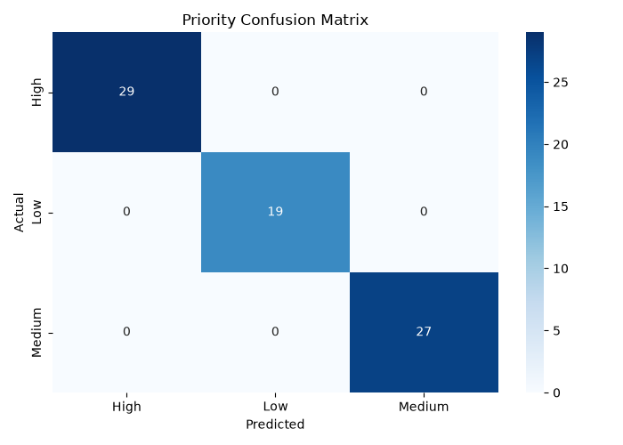
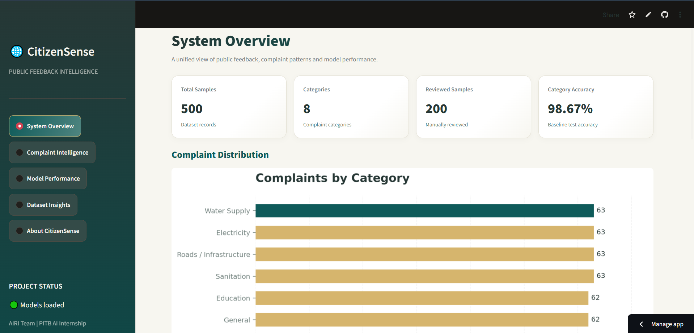
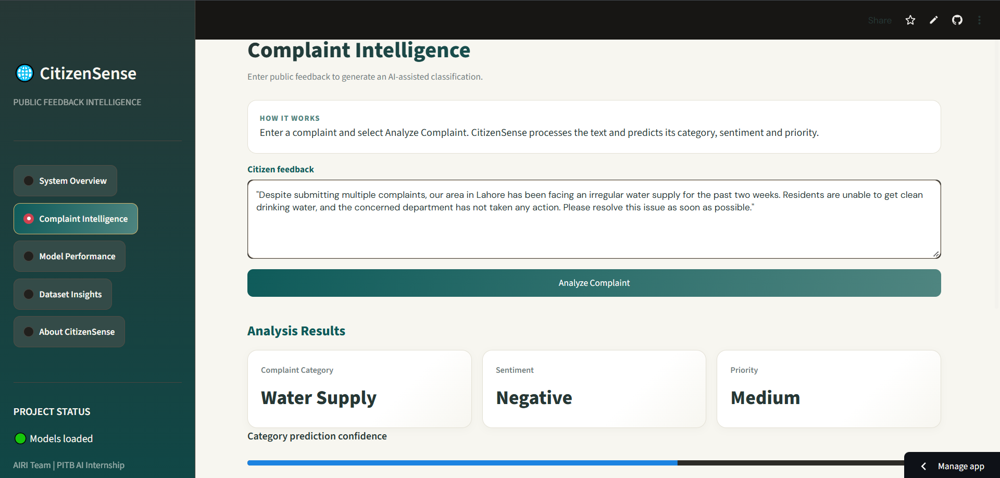
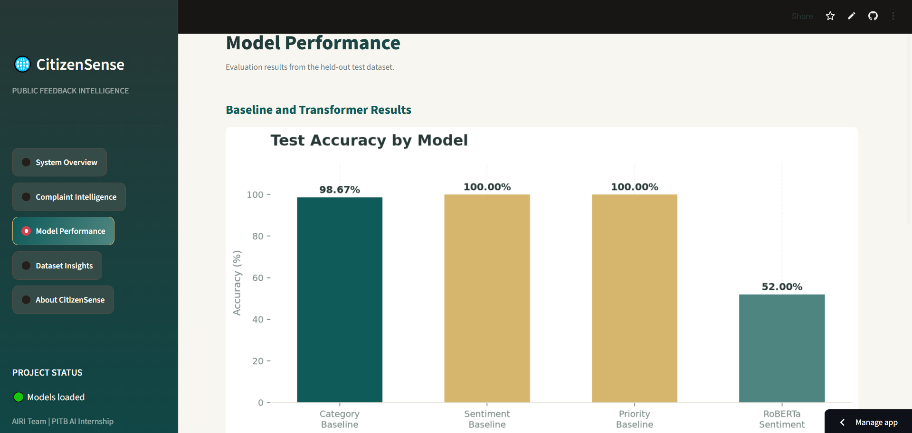
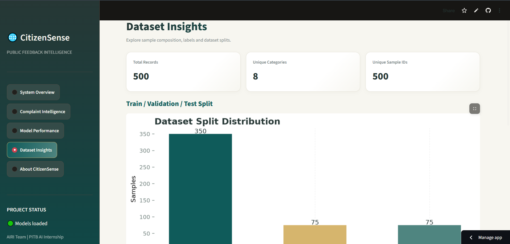
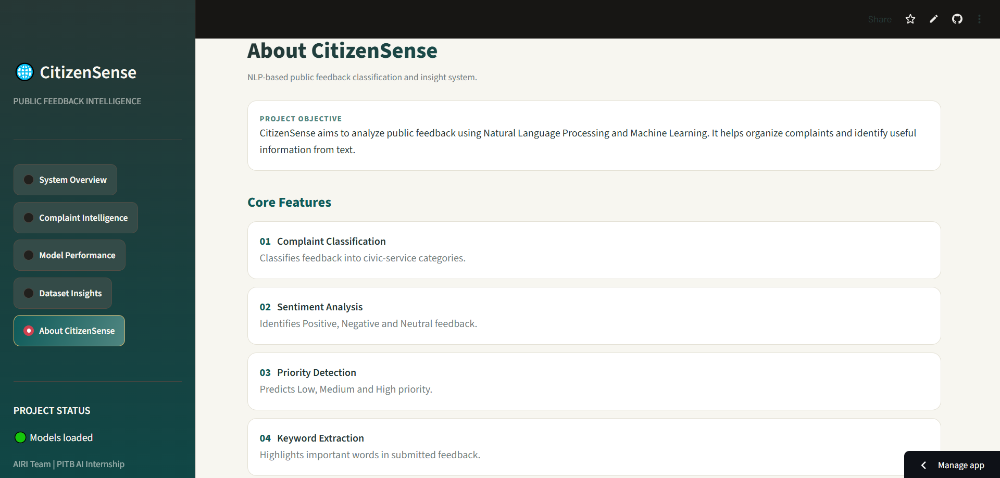

# CitizenSense
## NLP-Based Public Feedback Classification and Insight System

**Project:** AIRI Team — PITB AI Internship, Task 4  
**Project Type:** Natural Language Processing (NLP)  
**Interface:** Streamlit Dashboard

---

## 1. Introduction

CitizenSense is an NLP-based system designed to analyze public feedback and civic complaints. It helps classify submitted complaints into relevant categories and identify their sentiment and priority.

The system provides an interactive dashboard where users can submit complaint text and view the predicted category, sentiment, priority, confidence score, keywords, and suggested department.

## 2. Project Objectives

- Classify public complaints into relevant civic categories.
- Identify sentiment as Positive, Negative, or Neutral.
- Estimate complaint priority as High, Medium, or Low.
- Extract important keywords from complaint text.
- Evaluate machine learning and transformer-based approaches.
- Present predictions and evaluation results through a Streamlit dashboard.

## 3. Dataset Description

The project dataset contains **500 synthetic civic feedback samples**.

It includes eight complaint categories:

1. Education
2. General
3. Water Supply
4. Electricity
5. Roads / Infrastructure
6. Sanitation
7. Health
8. Traffic

The dataset was divided into:

| Dataset | Samples | Percentage |
|---|---:|---:|
| Training | 350 | 70% |
| Validation | 75 | 15% |
| Testing | 75 | 15% |
| **Total** | **500** | **100%** |

The project contains 200 records marked as manually reviewed. However, independent human annotation evidence is not yet established, so these records should not be presented as independently verified manual labels.

## 4. Data Preprocessing

The project includes a preprocessing workflow to prepare complaint text for machine learning.

The workflow includes:
- Text cleaning and normalization.
- Preparing processed complaint data.
- Creating training, validation, and testing datasets.
- Preparing text features for classification.

TF-IDF vectorization is used to convert text into numerical features for the baseline classification model.

## 5. Models Implemented

### 5.1 Baseline Machine Learning Model

The baseline category classifier uses:

- TF-IDF Vectorizer
- Logistic Regression

It predicts one of the eight complaint categories.

### 5.2 Sentiment and Priority Models

Additional classification models predict:

- Sentiment: Positive, Negative, Neutral.
- Priority: High, Medium, Low.

### 5.3 Transformer-Based Model

The project also uses the Hugging Face model:

`cardiffnlp/twitter-roberta-base-sentiment-latest`

It is used as a pretrained transformer sentiment-analysis pipeline.

## 6. Model Evaluation

Models were evaluated using accuracy, precision, recall, F1-score, and confusion matrices.

### 6.1 Baseline Category Classification

| Metric | Result |
|---|---:|
| Accuracy | 98.67% |
| Macro F1-score | 98.67% |
| Weighted F1-score | 98.67% |

The model correctly classified most test samples. Some confusion was observed between Water Supply and other categories, particularly Electricity.

### 6.2 Sentiment Classification

| Metric | Result |
|---|---:|
| Test Accuracy | 100% |
| Macro F1-score | 100% |
| Weighted F1-score | 100% |

### 6.3 Priority Classification

| Metric | Result |
|---|---:|
| Test Accuracy | 100% |
| Macro F1-score | 100% |
| Weighted F1-score | 100% |

### 6.4 Transformer Sentiment Classification

| Metric | Result |
|---|---:|
| Accuracy | 52% |
| Macro F1-score | 0.49 |
| Weighted F1-score | 0.48 |

The transformer pipeline performed less effectively on this dataset than the sentiment classification model.

**Evaluation note:** The perfect sentiment and priority scores require further independent validation. Since the dataset is synthetic, these results should not be interpreted as proof of equivalent real-world performance.

## 7. Error Analysis

The error analysis output contains 15 samples selected for review:

- 1 incorrectly classified sample.
- 14 correctly classified samples with low model confidence.

One identified classification error involved a Water Supply complaint being predicted as Electricity.

The analysis highlights the importance of reviewing ambiguous complaints and low-confidence predictions.

### Suggested Improvements

1. Collect and independently annotate real civic feedback.
2. Add more diverse examples for confusing complaint categories.
3. Review low-confidence predictions and improve the training data.

## 8. Keyword Extraction and Complaint Summary

CitizenSense extracts important keywords from submitted complaint text to help users understand the main issue.

The dashboard also displays a short text summary based on the complaint input.

Keyword extraction provides an additional way to inspect the key information in each complaint.

## 9. Streamlit Dashboard

The project includes an interactive Streamlit dashboard with five main sections:

1. **System Overview:** Introduction and system information.
2. **Complaint Intelligence:** Complaint input and prediction results.
3. **Model Performance:** Model evaluation metrics and charts.
4. **Dataset Insights:** Dataset information and category distribution.
5. **About CitizenSense:** Project information and limitations.

The Complaint Intelligence section displays category, sentiment, priority, confidence, keywords, summary, and suggested department.

The suggested department is an informational recommendation, not an official government routing decision.

## 10. Project Structure

The project is organized into the following main folders:

- `app/` — Streamlit application and demo files.
- `data/` — Dataset, annotation guidelines, and processed data.
- `models/` — Saved machine learning models and vectorizers.
- `notebooks/` — Notebook workspace.
- `outputs/` — Evaluation reports, predictions, and charts.
- `report/` — Final project documentation.
- `screenshots/` — Dashboard screenshots.
- `src/` — Data processing, training, and evaluation scripts.

## 11. Limitations

- The dataset consists of synthetic civic feedback rather than real public complaints.
- Independent human verification of the 200 records marked as reviewed has not been established.
- High scores on synthetic data may not represent performance on real-world complaints.
- The transformer sentiment pipeline achieved 52% accuracy on the available test set.
- Model confidence is an estimate and should not be treated as certainty.
- Suggested departments are informational and require human review.

## 12. Learning Outcomes

Through this project, the following practical concepts were applied:

- Text preprocessing and dataset preparation.
- TF-IDF feature extraction.
- Machine learning classification.
- Transformer-based sentiment analysis using Hugging Face.
- Model evaluation using classification metrics.
- Confusion matrix and error analysis.
- Streamlit dashboard development.
- Organizing a modular Python project.

## 13. Conclusion

CitizenSense demonstrates an end-to-end NLP workflow for analyzing civic feedback. It combines machine learning classification, transformer-based sentiment analysis, keyword extraction, model evaluation, and an interactive dashboard.

The project provides a foundation for a public feedback analysis system. Further work should focus on independently annotated real-world data, improved generalization, and additional evaluation before deployment in a real civic environment.

---

**Project:** CitizenSense  
**Internship:** AIRI Team — PITB  
**Task:** Task 4 — Final Project

---

# Final Report Addendum

## 14. Detailed Per-Class Evaluation

The following results are taken from the saved baseline classification report.

| Category | Precision | Recall | F1-score | Support |
|---|---:|---:|---:|---:|
| Education | 1.00 | 1.00 | 1.00 | 9 |
| Electricity | 0.90 | 1.00 | 0.95 | 9 |
| General | 1.00 | 1.00 | 1.00 | 9 |
| Health | 1.00 | 1.00 | 1.00 | 10 |
| Roads / Infrastructure | 1.00 | 1.00 | 1.00 | 10 |
| Sanitation | 1.00 | 1.00 | 1.00 | 10 |
| Traffic | 1.00 | 1.00 | 1.00 | 9 |
| Water Supply | 1.00 | 0.89 | 0.94 | 9 |

The baseline model achieved 98.67% accuracy on 75 test samples. Electricity has a precision of 0.90, while Water Supply has a recall of 0.89. These results indicate a small number of category-confusion errors.

## 15. Confusion Matrix Evidence

### Baseline Category Classifier

### Sentiment Classifier

### Priority Classifier

These figures provide visual evidence of the saved evaluation results.

## 16. Detailed Preliminary Error Analysis

The following 15 records were selected from the saved error-analysis output. They consist of one misclassification and fourteen correct predictions with low confidence.

**Review status:** This is an AI-assisted preliminary text review. The records have not yet been independently verified by a human reviewer. The explanations are plausible text-based observations, not confirmed explanations of the model's internal behaviour.

| Sample ID | Complaint Text | Actual Category | Predicted Category | Confidence | Status | Preliminary Review Reason |
|---|---|---|---|---:|---| 
| CS-0131 | I would like to report irregular water supply. Please review the reported condition. It requires urgent attention due to its serious impact. | Water Supply | Electricity | 0.238 | Misclassification | Water supply is explicitly mentioned, but the model predicted Electricity. Possible category confusion or weak learned feature association. |
| CS-0026 | I would like to report broken streetlights. Please record this issue for review. Please arrange an inspection in a reasonable time. | Roads / Infrastructure | Roads / Infrastructure | 0.2312 | Low-confidence prediction | Broken streetlights may overlap road infrastructure and electricity-related features. |
| CS-0005 | I would like to report damaged road surfaces. Residents are dissatisfied with the current situation. Immediate assessment is needed because public safety may be affected. | Roads / Infrastructure | Roads / Infrastructure | 0.2388 | Low-confidence prediction | Road surface damage is identifiable, but much of the remaining text is generic. |
| CS-0160 | I would like to report irregular water supply. Thank you for addressing this matter. Please arrange an inspection in a reasonable time. | Water Supply | Water Supply | 0.2678 | Low-confidence prediction | Irregular water supply is identifiable, but the complaint contains limited supporting details. |
| CS-0010 | I would like to report poor road maintenance. This problem is affecting everyday activities. Immediate assessment is needed because public safety may be affected. | Roads / Infrastructure | Roads / Infrastructure | 0.2783 | Low-confidence prediction | Poor road maintenance is identifiable, while the additional wording provides limited category-specific context. |
| CS-0123 | I would like to report low voltage in residential areas. I appreciate the efforts made so far. A timely response would help resolve the matter. | Electricity | Electricity | 0.2878 | Low-confidence prediction | Low voltage is an electricity-related signal, but the complaint provides little additional context. |
| CS-0069 | I would like to report damaged public power infrastructure. The recent improvements have been helpful. Please escalate this matter for urgent action. | Electricity | Electricity | 0.2984 | Low-confidence prediction | Power infrastructure indicates electricity, but the remaining wording is generic. |
| CS-0247 | I would like to report uncollected garbage. This matter is being brought to your attention. This issue needs attention to prevent further inconvenience. | Sanitation | Sanitation | 0.3073 | Low-confidence prediction | Uncollected garbage indicates sanitation, but location and collection details are absent. |
| CS-0128 | I would like to report shortage of clean drinking water. Please review the reported condition. It would be helpful to include this in future planning. | Water Supply | Water Supply | 0.3096 | Low-confidence prediction | Shortage of clean drinking water identifies the category, but the circumstances are not described. |
| CS-0413 | I would like to report poor public transport coordination. This problem is affecting everyday activities. Please arrange an inspection in a reasonable time. | Traffic | Traffic | 0.3167 | Low-confidence prediction | Public transport coordination relates to traffic, but the specific coordination problem is not explained. |
| CS-0007 | I would like to report damaged road surfaces. The situation is disappointing for residents. Immediate assessment is needed because public safety may be affected. | Roads / Infrastructure | Roads / Infrastructure | 0.3176 | Low-confidence prediction | Damaged road surfaces identify the category, but the supporting context is limited. |
| CS-0043 | I would like to report poor road maintenance. This ongoing problem is causing frustration. This issue needs attention to prevent further inconvenience. | Roads / Infrastructure | Roads / Infrastructure | 0.3288 | Low-confidence prediction | Poor road maintenance is identifiable, but the complaint provides few specific details. |
| CS-0371 | I would like to report shortage of classroom facilities. The current situation requires an assessment. It would be helpful to include this in future planning. | Education | Education | 0.3387 | Low-confidence prediction | Classroom facilities indicate education, but the exact facility shortage is not specified. |
| CS-0349 | I would like to report lack of educational resources. Thank you for addressing this matter. It requires urgent attention due to its serious impact. | Education | Education | 0.3464 | Low-confidence prediction | Lack of educational resources indicates education, but the missing resources are not identified. |
| CS-0109 | I would like to report damaged public power infrastructure. This matter is being brought to your attention. Immediate assessment is needed because public safety may be affected. | Electricity | Electricity | 0.3502 | Low-confidence prediction | Damaged power infrastructure indicates electricity, but the complaint gives limited additional context. |

### Error Analysis Interpretation

- One sample, CS-0131, was misclassified: a Water Supply complaint was predicted as Electricity.
- Fourteen other samples were correctly classified but had relatively low prediction confidence.
- Some complaint texts contain generic wording and limited supporting context.
- Streetlight complaints may contain overlapping infrastructure and electricity-related terms.
- These observations suggest that more varied and independently labelled examples may improve category separation.

### Recommended Improvements

1. Collect real civic complaints from appropriate sources, remove personal information, and obtain independent human annotations.
2. Add more diverse examples for categories with overlapping vocabulary, especially Water Supply, Electricity, and Roads / Infrastructure.
3. Review low-confidence predictions with a human-in-the-loop process and use verified corrections to improve future training data.

## 17. Dashboard Screenshots

### System Overview

### Complaint Intelligence

### Model Performance

### Dataset Insights

### About CitizenSense

## 18. Project Links

- **GitHub Repository:** https://github.com/mahnoorinnovation/CitizenSense
- **Live Streamlit Dashboard:** https://citizensense-hae5xfzbtnar2wq9tka4x2.streamlit.app/

## 19. LinkedIn-Ready Project Summary

**CitizenSense — NLP-Based Public Feedback Classification and Insight System**

Developed an end-to-end NLP project as part of the AIRI Team PITB AI Internship. The system analyzes synthetic civic feedback using TF-IDF and Logistic Regression for complaint-category classification, classification models for sentiment and priority, and a pretrained Hugging Face transformer pipeline for sentiment analysis.

Implemented text preprocessing, model evaluation, confusion matrices, preliminary error analysis, keyword extraction, complaint summaries, and an interactive Streamlit dashboard.

**Technologies:** Python, Pandas, Scikit-learn, TF-IDF, Logistic Regression, Hugging Face Transformers, Streamlit.

**Key evaluation result:** The baseline category classifier achieved 98.67% accuracy on a held-out test set of 75 synthetic samples. Results require further validation on independently labelled real-world data.

## 20. Final Evaluation and Limitations

The category baseline achieved 98.67% accuracy. The sentiment and priority classifiers each achieved 100% accuracy on the available synthetic test set. The pretrained transformer sentiment pipeline achieved 52% accuracy, with a weighted F1-score of 0.48.

Perfect sentiment and priority scores on synthetic data should be interpreted cautiously. They do not establish real-world generalization. Independent human annotation evidence for the 200 records marked as reviewed has not been established. The 15 preliminary error-analysis records also remain pending human verification.

The suggested department is informational guidance only. Predictions and priority estimates should be reviewed by people before any real public-service decision.

## 21. Final Conclusion

CitizenSense demonstrates a practical NLP workflow that combines text processing, machine learning, transformer-based sentiment analysis, evaluation, preliminary error analysis, keyword extraction, summarization, and an interactive dashboard.

The project provides a working prototype and a foundation for further development. The next important steps are independent human annotation, testing on real-world civic feedback, reviewing low-confidence predictions, and validating the system with broader data.

---

**Project:** CitizenSense  
**Internship:** AIRI Team — PITB  
**Task:** Task 4 — Final Project
